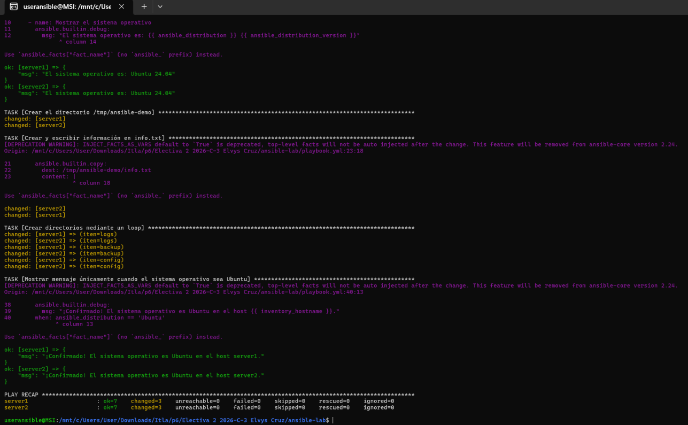

# Práctica 2do Parcial - Ansible

## Objetivo de la práctica
Administrar y automatizar la configuración de servidores Linux ejecutados en contenedores Docker utilizando Ansible, aplicando tareas de gestión de archivos, creación de directorios mediante bucles y ejecución condicional basada en el sistema operativo.

## Comandos para iniciar los contenedores
```bash
docker compose up -d

## Comando para ejecutar el playbook
ansible-playbook -i inventory.ini playbook.yml

## Evidencia de ejecución
   